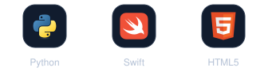
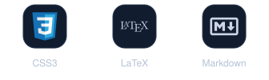
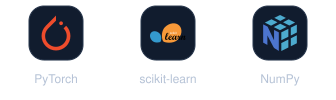
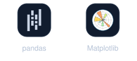
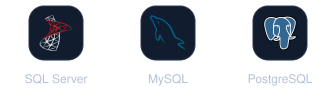
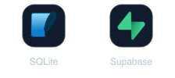
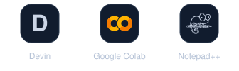
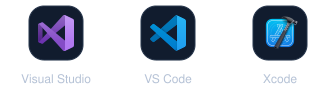
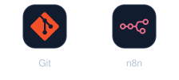

<picture>
  <source media="(prefers-color-scheme: dark)" srcset="./assets/profile-banner-dark.634a53cb8a.svg" />
  <source media="(prefers-color-scheme: light)" srcset="./assets/profile-banner-light.3284d5f237.svg" />
  
</picture>

## About me

Software Engineering student based in Lima, Peru, working toward a career in **Machine Learning Engineering**. Interested in understanding data, building models, and turning ideas into useful software.

**Currently learning**

- Machine Learning and data analysis with Python.
- Model development with scikit-learn and PyTorch.

**Beyond code:** video games, electronic music, and anime—especially **One Piece**.

 

## Skills

<h4>Languages</h4>

<h4>Machine Learning / Data Science</h4>

<h4>Databases</h4>

<h4>Hosting / SaaS</h4>

<h4>IDEs / Editors</h4>

<h4>Other Tools &amp; Technologies</h4>

## Certifications

**GitHub Foundations**

 

## GitHub analytics

 

<picture>
  <source media="(prefers-color-scheme: dark)" srcset="./assets/generated/github-contribution-grid-snake-dark.svg" />
  <source media="(prefers-color-scheme: light)" srcset="./assets/generated/github-contribution-grid-snake.svg" />
  
</picture>

<picture>
  <source media="(max-width: 540px) and (prefers-color-scheme: dark)" srcset="./assets/footer-dark-compact.58bd63c2b7.svg" />
  <source media="(max-width: 540px) and (prefers-color-scheme: light)" srcset="./assets/footer-light-compact.f4b5eff0de.svg" />
  <source media="(prefers-color-scheme: dark)" srcset="./assets/footer-dark.01ce3de7ca.svg" />
  <source media="(prefers-color-scheme: light)" srcset="./assets/footer-light.b17115f965.svg" />
  
</picture>

